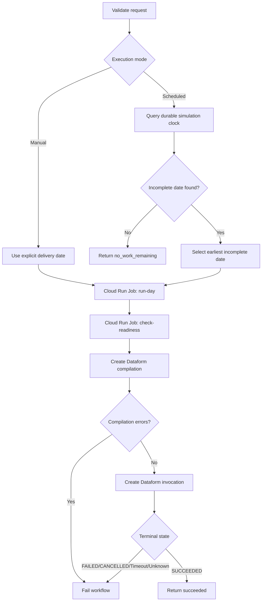

# Mercury Production Platform Design

## Status

Draft

## Date

2026-10-21

## Purpose

This document defines the implementation design for operating Mercury as a scheduled, observable, and reproducible production platform.

It translates ADR-014 into deployable runtime, orchestration, configuration, identity, infrastructure, failure-handling, and validation boundaries.

## Governing Decisions

This design implements:

- [ADR-009: Decouple Source Delivery from Pipeline Orchestration](../decisions/ADR-009-Decouple%20Source%20Delivery%20from%20Pipeline%20Orchestration.md);
- [ADR-010: Persist Source-Level Historical Replay State and Derive Date-Level Completion](../decisions/ADR-010-Persist%20Source-Level%20Historical%20Replay%20State%20and%20Derive%20Date-Level%20Completion.md);
- [ADR-011: Data Security, Privacy, and Data-Leak Prevention](../decisions/ADR-011-Data%20Security,%20Privacy,%20and%20Data-Leak%20Prevention.md);
- [ADR-012: Staging Layer Standardization and Semantic Contracts](../decisions/ADR-012-Staging%20Layer%20Standardization%20and%20Semantic%20Contracts.md);
- [ADR-013: Data Quality Anomaly Disposition and Monitoring Contract](../decisions/ADR-013-Data%20Quality%20Anomaly%20Disposition%20and%20Monitoring%20Contract.md);
- [ADR-014: Orchestrate Production Execution with Cloud Workflows](../decisions/ADR-014-Orchestrate-Production-Execution-with-Cloud-Workflows.md).

---

## 1. Scope

This document defines:

- the production execution topology;
- supported execution modes;
- the production ingestion command;
- runtime configuration;
- logical delivery-date handling;
- Olist simulation-input boundaries;
- Cloud Run container behavior;
- workflow state transitions;
- Dataform invocation;
- workload identities;
- Terraform ownership;
- retry and failure behavior;
- operational traceability;
- production validation requirements.

This document does not define:

- connector-specific extraction logic;
- Raw table schemas;
- staging or canonical contracts;
- anomaly-specific dispositions;
- final notification channels;
- data-product schemas;
- production environment promotion beyond the current development project.

Those concerns remain governed by their existing contracts or later implementation designs.

---

## 2. Production Architecture

Mercury's production execution path is:

```text
Cloud Scheduler
      |
      v
Cloud Workflows
      |
      v
Cloud Run ingestion job
      |
      +----> GCS Raw
      |
      +----> BigQuery Raw
      |
      +----> BigQuery metadata
      |
      v
Date-completion validation
      |
      v
Dataform workflow invocation
      |
      +----> staging
      |
      +----> canonical
      |
      v
Quality evaluation and monitoring
```

The orchestration path coordinates services without combining their data permissions.

A successful scheduler invocation does not itself represent successful publication.

Production publication succeeds only when the required ingestion, completion, transformation, and blocking-quality stages succeed.

---

## 3. Execution Modes

Mercury separates scheduled progression, manual execution, historical replay, and targeted recovery.

| Mode | Delivery-date resolution | Purpose |
| --- | --- | --- |
| Scheduled day | Select the earliest incomplete date from the governed historical simulation range | Advance the Olist simulation by exactly one historical day |
| Manual day | Use one explicitly supplied historical delivery date | Re-run or validate a known logical delivery |
| Historical replay | Process an explicit controlled date range | Bootstrap or intentionally rebuild multiple historical dates |
| Targeted recovery | Select work from durable failure and completion evidence | Repair a justified incomplete execution without broad replay |

The initial production workflow supports scheduled-day and manual-day execution.

Historical replay and targeted recovery remain operator-initiated until separate production workflow contracts are implemented.

A scheduled execution must process no more than one historical delivery date.

It must never silently expand into a multi-day replay.

### 3.1 Scheduled simulation behavior

Olist is a finite historical dataset used to simulate a daily incremental source.

Mercury preserves two distinct dates:

| Date | Meaning |
| --- | --- |
| `delivery_date` | Historical business date represented by the source records |
| `ingestion_date` | Simulated date on which those records become available to Mercury |

The governed Olist timing rule is:

```text
ingestion_date = delivery_date + 1 calendar day
```

Scheduled execution must not derive the logical delivery date from the current real-world date.

Instead, it queries durable replay state across the configured simulation range and selects the earliest date that has not completed all governed daily source objects.

The governed daily source set is:

```text
orders
order_items
payments
reviews
```

When every date in the configured range is complete, the workflow returns `no_work_remaining` without starting ingestion or Dataform.

### 3.2 Manual behavior

Manual execution requires an explicit `delivery_date`.

It is intended for:

- controlled reruns;
- operational diagnosis;
- replaying a known historical date;
- validating idempotent behavior;
- recovering a date through an approved operator action.

Manual execution does not advance or mutate a separate simulation cursor.

The same durable replay state used by scheduled execution determines whether previously completed source deliveries remain logically complete.

---

## 4. Production Runtime Commands

Mercury exposes two Python module commands from the same production image.

### 4.1 Daily ingestion command

```text
python -m mercury_ingestion.cli run-day \
    --delivery-date YYYY-MM-DD
```

The command:

1. parses the requested historical delivery date;
2. validates required runtime configuration;
3. prepares an ephemeral source workspace;
4. materializes the approved immutable Olist simulation input from GCS;
5. constructs the existing Olist simulator and source provider;
6. generates only the requested daily source batch;
7. assigns the governed simulated ingestion date;
8. constructs GCS Raw storage and the BigQuery Raw loader;
9. constructs replay-state and provenance stores;
10. calls `HistoricalReplayRunner.run_day()`;
11. emits one PII-safe structured terminal summary;
12. exits according to the terminal result.

The production adapter remains thin.

It does not duplicate behavior owned by the existing ingestion, simulation, replay-state, provenance, storage, or warehouse components.

### 4.2 Durable readiness command

```text
python -m mercury_ingestion.cli check-readiness \
    --delivery-date YYYY-MM-DD
```

The command independently queries the BigQuery-backed replay-state store through `get_completed_for_date()`.

It compares the durable logical-completion set with the exact governed daily source contract.

A date is ready only when:

```text
completed source objects
    ==
orders + order_items + payments + reviews
```

Missing or unexpected completed source objects block transformation.

The command:

1. parses the requested delivery date;
2. validates runtime configuration;
3. constructs the BigQuery replay-state store;
4. reads monotonic logical completion;
5. evaluates the exact expected source set;
6. emits one PII-safe structured terminal summary;
7. exits without executing ingestion or provisioning resources.

A later failed retry does not revoke an earlier durable success.

### 4.3 Exit behavior

Both commands use the same governed process-level exit boundary.

| Exit code | `run-day` meaning | `check-readiness` meaning |
| ---: | --- | --- |
| `0` | Requested delivery completed successfully | Delivery date is durably ready for Dataform |
| `1` | Requested delivery was incomplete or partially successful | Delivery date is blocked because its completion contract is not satisfied |
| `2` | Execution failed before a valid delivery result was produced | Readiness could not be evaluated safely |
| `64` | Runtime configuration or command input was invalid | Runtime configuration or command input was invalid |

Only exit code `0` permits the workflow to proceed to the next gate.

### 4.4 Structured output contracts

The `run-day` terminal summary contains:

- workflow execution identifier;
- ingestion `run_id`;
- environment;
- logical delivery date;
- source count;
- completed source count;
- failed source count;
- final status;
- safe failure category where applicable.

The `check-readiness` terminal summary contains:

- workflow execution identifier;
- environment;
- logical delivery date;
- expected source objects;
- completed source objects;
- missing source objects;
- unexpected source objects;
- readiness Boolean;
- final status;
- safe failure category where applicable.

Neither command logs:

- source records;
- credentials or tokens;
- complete customer identifiers;
- sensitive object contents;
- unrestricted provider exception payloads.

---

## 5. Runtime Configuration

Infrastructure identifiers must not remain hardcoded in the production runtime.

Mercury separates:

1. Cloud Run Job environment configuration;
2. Cloud Workflows execution arguments;
3. the logical delivery date passed to the CLI.

### 5.1 Cloud Run Job environment

The ingestion container reads infrastructure configuration from environment variables.

| Variable | Responsibility |
| --- | --- |
| `MERCURY_ENVIRONMENT` | Identifies the runtime environment |
| `MERCURY_PROJECT_ID` | GCP project containing Mercury resources |
| `MERCURY_REGION` | Regional runtime and BigQuery location |
| `MERCURY_RAW_BUCKET` | Immutable Raw landing bucket |
| `MERCURY_RAW_DATASET` | BigQuery Raw dataset |
| `MERCURY_METADATA_DATASET` | BigQuery operational metadata dataset |
| `MERCURY_SOURCE_INPUT_URI` | Durable Olist simulation-input location |
| `MERCURY_WORKFLOW_EXECUTION_ID` | Correlates the job with its Cloud Workflows execution |

The workflow overrides `MERCURY_WORKFLOW_EXECUTION_ID` for each Cloud Run Job execution using the built-in `GOOGLE_CLOUD_WORKFLOW_EXECUTION_ID`.

No credentials, tokens, or service-account key files are supplied through environment variables.

Authentication uses Application Default Credentials from the workload identity.

### 5.2 Workflow request contract

The production workflow accepts a governed request object.

| Field | Required | Responsibility |
| --- | --- | --- |
| `execution_mode` | Yes | Selects `manual` or `scheduled` behavior |
| `delivery_date` | Manual only | Explicit historical delivery date |
| `simulation_start_date` | Scheduled only | First permitted historical simulation date |
| `simulation_end_date` | Scheduled only | Last permitted historical simulation date |
| `metadata_dataset` | Scheduled only | Dataset containing durable replay state |
| `ingestion_job_name` | Yes | Cloud Run Job used for ingestion and readiness evaluation |
| `dataform_repository` | Yes | Managed Dataform repository identifier |
| `dataform_pipeline_path` | No | Relative Git path containing the Dataform project; defaults to `dataform` |
| `dataform_git_commitish` | No | Git branch, tag, or commit SHA to compile; defaults to `main` |
| `dataform_service_account` | Yes | Dedicated identity used for Dataform execution |
| `cloud_run_timeout_seconds` | No | Maximum duration of each Cloud Run connector call |
| `dataform_timeout_seconds` | No | Maximum duration allowed for Dataform execution |
| `dataform_poll_seconds` | No | Interval between Dataform state checks |

The workflow obtains its project, region, and execution identifier from Cloud Workflows built-in environment variables.

### 5.3 Validation boundary

Configuration validation occurs before source processing begins.

The workflow rejects:

- missing execution mode;
- unsupported execution modes;
- missing common resource identifiers;
- manual execution without `delivery_date`;
- scheduled execution with an explicit `delivery_date`;
- scheduled execution without a complete simulation range;
- scheduled execution without a metadata dataset;
- a simulation start date later than its end date.

The CLI independently validates command syntax and container runtime configuration.

Missing, blank, malformed, or contradictory required values must fail clearly without exposing sensitive provider details.

---

## 6. Logical Delivery Date and Simulation Clock

The workflow resolves exactly one logical delivery date before starting ingestion.

The Cloud Run Job receives that resolved date as:

```text
--delivery-date YYYY-MM-DD
```

The job must not independently substitute another delivery date.

### 6.1 Manual resolution

Manual execution requires one explicit historical `delivery_date`.

The workflow passes that value unchanged to both:

```text
run-day
check-readiness
```

This path supports controlled reruns, diagnosis, replay, and recovery.

### 6.2 Scheduled resolution

Scheduled execution uses durable replay state as the historical simulation clock.

The workflow queries:

```text
metadata.historical_replay_state
```

across the configured inclusive range:

```text
simulation_start_date
    through
simulation_end_date
```

For each candidate date, the workflow evaluates durable `success | warehouse` evidence for:

```text
orders
order_items
payments
reviews
```

It selects:

```text
the earliest date with fewer than four
distinct governed completed source objects
```

The query:

- generates the complete configured date range;
- left joins durable completion evidence;
- excludes unrelated source objects;
- counts each expected source object once;
- orders candidates chronologically;
- returns at most one date.

This selection is deterministic and based on durable warehouse evidence rather than the current real-world date.

### 6.3 Simulation progression

A scheduled execution processes no more than one historical delivery date.

For a selected historical delivery date `D`:

```text
delivery_date = D
ingestion_date = D + 1 calendar day
```

The Olist source provider remains the single owner of this timing rule.

The workflow owns only the selection of the next incomplete delivery date.

If ingestion or readiness fails, the date remains incomplete and is selected again by a future scheduled execution unless an approved recovery action completes it.

If every date in the configured range is complete, the workflow returns:

```text
final_status = no_work_remaining
```

It does not start Cloud Run ingestion, readiness evaluation, Dataform compilation, or Dataform execution.

### 6.4 Durable completion semantics

Simulation progression is monotonic.

A source object that has reached `success | warehouse` remains logically complete even if a later replay attempt fails.

The simulation clock therefore uses logical completion rather than latest-attempt state.

The independent readiness gate still requires the exact governed source set before Dataform is permitted to run.

---

## 7. Olist Simulation Input

Olist is a simulated source domain rather than a live operational source.

The production container must not rely on repository-relative data or embed mutable source deliveries inside the image.

The initial production simulation boundary will be:

```text
Durable simulation input
        |
        v
Temporary Cloud Run workspace
        |
        v
Olist source simulation
        |
        v
Existing ingestion framework
```

The ingestion identity receives read-only access to the approved simulation input.

Generated local files exist only for the duration of the job.

Durable platform evidence remains in:

- immutable GCS Raw objects;
- BigQuery Raw tables;
- replay-state history;
- artifact provenance;
- warehouse-load provenance.

A future real source provider may replace the Olist simulation provider without changing the production orchestration contract.

---

## 8. Cloud Run Job

The ingestion runtime will be packaged as a container and deployed as a Cloud Run Job.

The container will:

- install the Mercury ingestion package;
- expose the production module entry point;
- contain no credentials;
- contain no mutable environment-specific configuration;
- contain no durable execution state;
- use Application Default Credentials;
- write only temporary files to its local filesystem;
- terminate after completing its requested operation.

The image will be stored in Artifact Registry.

Production job revisions should reference an immutable image digest where practical.

The initial job will use one task. Source-level isolation remains handled by the ingestion framework rather than Cloud Run task parallelism.

---

## 9. Workflow Contract

The production workflow source is stored at:

```text
workflows/production_daily.yaml
```

It coordinates one governed production unit of work.



The workflow uses the workflow execution identifier as the correlation identity for both Cloud Run Job executions.

### 9.1 Request and date-resolution gate

The workflow first validates common configuration and selects one execution mode.

For `manual` execution:

- `delivery_date` is required;
- the supplied date is passed unchanged to the runtime commands;
- simulation-range parameters do not select or advance the date.

For `scheduled` execution:

- an explicit `delivery_date` is prohibited;
- `simulation_start_date`, `simulation_end_date`, and `metadata_dataset` are required;
- the start date must not be later than the end date;
- BigQuery replay state is queried for the earliest incomplete historical date;
- no more than one date is selected.

If the simulation-clock query does not complete safely, the workflow fails.

If the query returns no incomplete date, the workflow returns:

```text
final_status = no_work_remaining
```

No ingestion or transformation work is started in that branch.

### 9.2 Ingestion gate

The workflow executes the production image as a Cloud Run Job with:

```text
run-day --delivery-date YYYY-MM-DD
```

The workflow injects:

```text
MERCURY_WORKFLOW_EXECUTION_ID
```

as a per-execution environment override.

The Cloud Run connector waits for the Job execution to finish.

A non-zero process exit, Cloud Run execution failure, or connector timeout prevents the workflow from proceeding.

The structured CLI summary remains available in Cloud Logging as governed execution evidence.

### 9.3 Durable readiness gate

Successful completion of `run-day` is necessary but not sufficient for transformation.

The workflow executes the same production image again with:

```text
check-readiness --delivery-date YYYY-MM-DD
```

This command independently queries durable replay state.

The readiness gate requires the exact completed source set:

```text
orders
order_items
payments
reviews
```

The workflow stops before Dataform when:

- a required source object is missing;
- an unexpected source object is included in the completed set;
- readiness evaluation fails;
- the readiness Job times out;
- the command returns any exit code other than `0`.

This second gate protects downstream publication from relying only on the terminal state of the ingestion attempt.

### 9.4 Dataform compilation gate

After durable readiness succeeds, the workflow creates a fresh Dataform compilation result.

The request identifies:

- the managed Dataform repository;
- the approved Git branch, tag, or commit SHA;
- the relative pipeline path containing Mercury’s Dataform project.

Mercury’s Dataform project is located at:

```text
dataform/
```

The compilation request therefore includes:

```text
codeCompilationConfig.pipelineConfig.pipelineType = DATAFORM
codeCompilationConfig.pipelineConfig.path = dataform
```

This ensures that Dataform resolves `workflow_settings.yaml` from the correct repository subdirectory.

Compilation creation uses retry behavior for transient HTTP failures.

The workflow must not create a workflow invocation when `compilationErrors` contains any entry.

### 9.5 Dataform transformation gate

After compilation succeeds, the workflow creates a Dataform workflow invocation using the dedicated Dataform service account.

No included targets or tags are supplied, so the invocation executes the approved full graph represented by the compiled project.

That graph includes:

- staging tables;
- canonical intermediate models;
- canonical dimensions, facts, and bridges;
- blocking staging assertions;
- blocking canonical assertions;
- governed non-blocking observation views.

The workflow polls the invocation until it reaches a governed terminal state.

| State | Workflow behavior |
| --- | --- |
| `SUCCEEDED` | Publication succeeds |
| `FAILED` | Workflow fails |
| `CANCELLED` | Workflow fails |
| `CANCELING` | Polling continues until a terminal state or timeout |
| `RUNNING` | Polling continues |
| Unknown state | Workflow fails |
| Execution deadline exceeded | Workflow fails |

A blocking assertion failure causes the Dataform invocation to fail and therefore prevents successful publication.

Non-blocking observation views do not fail publication merely because they contain anomaly rows.

Failure to execute a required observation remains an action failure and therefore fails the invocation.

### 9.6 Terminal results

A successful workflow returns:

- workflow execution identifier;
- execution mode;
- resolved historical delivery date;
- ingestion status;
- readiness status;
- Dataform terminal state;
- compilation-result resource name;
- workflow-invocation resource name;
- final status.

The successful final status is:

```text
succeeded
```

A completed scheduled simulation range returns:

```text
no_work_remaining
```

All other unhandled gate failures fail the workflow execution.

Provider exception details must remain governed through Cloud Logging and must not be copied into unrestricted user-facing output.

---

## 10. Workload Identities

| Identity | Responsibility |
| --- | --- |
| Scheduler identity | Start the approved production workflow |
| Workflow identity | Invoke and inspect approved production services |
| Ingestion identity | Write Raw artifacts, load Raw tables, and update metadata |
| Dataform identity | Read Raw and manage staging and canonical relations |

No identity may receive broad Owner, Editor, BigQuery Admin, Storage Admin, or IAM administration roles.

### 10.1 Scheduler identity

May:

- start the approved workflow.

Must not:

- invoke arbitrary workflows;
- invoke the ingestion job directly;
- access business data.

### 10.2 Workflow identity

May:

- execute and inspect the approved Cloud Run Job;
- invoke and inspect the approved Dataform workflow;
- perform the minimum required completion check.

Must not:

- write Raw data;
- manage analytical relations;
- administer infrastructure.

### 10.3 Ingestion identity

May:

- read approved simulation inputs;
- create immutable Raw objects;
- load approved BigQuery Raw relations;
- write operational metadata;
- execute required BigQuery jobs.

Must not:

- manage staging or canonical relations;
- invoke Dataform;
- administer datasets or IAM.

### 10.4 Dataform identity

Retains the validated Phase 3 boundary:

- project-level BigQuery job execution;
- read-only BigQuery Raw access;
- staging relation management;
- canonical relation management;
- no GCS Raw access;
- no metadata access;
- no dataset or IAM administration.

---

## 11. Terraform Ownership

Terraform will manage infrastructure boundaries.

Application workloads will manage data within those boundaries.

| Resource | Owner |
| --- | --- |
| Service APIs | Terraform |
| Datasets and buckets | Terraform |
| Service accounts and IAM | Terraform |
| Artifact Registry | Terraform |
| Cloud Run Job | Terraform |
| Cloud Workflow | Terraform |
| Cloud Scheduler job | Terraform |
| Monitoring resources | Terraform |
| Raw objects | Ingestion runtime |
| BigQuery Raw relations | Ingestion framework |
| Operational metadata relations | Ingestion framework within the Terraform-managed dataset |
| Staging and canonical relations | Dataform |

Existing resources must be evaluated for import before Terraform attempts to create replacements.

Correctly configured data-bearing resources must not be destroyed merely to introduce Terraform ownership.

---

## 12. Retry and Failure Model

Retries must be conservative and compatible with Mercury's idempotency contracts.

Automatic retries are appropriate only where an operation is safe to repeat.

A retry must preserve:

- immutable Raw object behavior;
- deterministic object naming;
- append-only replay-state history;
- run-level identifiers;
- provenance for repeated attempts;
- source-level failure isolation.

The workflow must not retry indefinitely.

Ambiguous or contradictory states must route to reconciliation or manual review.

Transformation retries require confirmed complete Raw input and must not bypass failed assertions.

Exact retry counts and timeouts will be selected during resource implementation and validated against realistic execution duration.

---

## 13. Observability

Every production run must correlate:

- scheduler invocation;
- workflow execution;
- Cloud Run execution;
- ingestion `run_id`;
- logical delivery date;
- source-level replay state;
- Raw artifact provenance;
- warehouse-load provenance;
- Dataform invocation;
- quality evaluation;
- final workflow status.

Cloud Logging will receive structured operational events.

Cloud Monitoring will initially cover:

- workflow failure;
- Cloud Run Job failure;
- ingestion incompleteness;
- Dataform failure;
- unknown quality state;
- missing scheduled execution where detectable.

Historical quality evaluation, baseline comparison, and alert disposition remain governed by [ADR-013](../decisions/ADR-013-Data%20Quality%20Anomaly%20Disposition%20and%20Monitoring%20Contract.md).

---

## 14. Security Requirements

The production platform must:

- use keyless workload authentication;
- use separate workload identities;
- prevent public invocation;
- prevent public bucket access;
- prevent destructive Raw mutation;
- avoid credentials in container images;
- avoid secrets in environment-variable source files;
- redact unsafe exception details;
- preserve least-privilege dataset access;
- protect Terraform state and local credentials.

Security validation must include both permitted and prohibited operations for every new workload identity.

---

## 15. Validation Requirements

Mercury separates local contract validation from deployed platform validation.

### 15.1 Completed local validation

The following implementation boundaries have automated test coverage:

- production runtime configuration parsing and validation;
- GCS source-input materialization;
- reusable Olist replay-runner construction;
- replay `run_id` propagation;
- production `run-day` command behavior;
- production `check-readiness` command behavior;
- PII-safe structured terminal summaries;
- governed process exit codes;
- durable readiness evaluation;
- missing and unexpected source detection;
- manual and scheduled execution-mode separation;
- historical simulation-clock selection contract;
- one-date-per-scheduled-execution behavior;
- no-work-remaining behavior;
- Cloud Run command ordering;
- workflow execution-identity propagation;
- Dataform compilation and invocation ordering;
- Dataform service-account configuration;
- Dataform repository-subdirectory targeting;
- Dataform terminal-state handling;
- absence of hardcoded development resource identifiers;
- full ingestion regression-suite compatibility.

The workflow contract tests verify that:

```text
run-day
    precedes
check-readiness
    precedes
Dataform compilation
    precedes
Dataform invocation
```

The tests also verify that scheduled execution uses durable replay state rather than the current real-world date.

### 15.2 Validation deferred until deployment

The following controls require deployed GCP resources and remain pending:

- container image build in an approved build environment;
- container vulnerability and dependency scanning;
- Artifact Registry publication;
- keyless Cloud Run authentication;
- Cloud Run Job environment configuration;
- permitted ingestion operations under the ingestion identity;
- prohibited ingestion operations under the ingestion identity;
- workflow identity access to the Cloud Run Job;
- workflow identity read access to replay-state metadata;
- workflow identity access to the Dataform API;
- workflow identity permission to act as the Dataform identity where required;
- managed Dataform repository Git connectivity;
- managed Dataform compilation of the `dataform/` subdirectory;
- authoritative Cloud Workflows DSL validation during deployment;
- Cloud Scheduler invocation;
- ingestion failure propagation through Cloud Workflows;
- readiness failure propagation through Cloud Workflows;
- Dataform compilation-error propagation;
- blocking assertion propagation;
- non-blocking observation execution;
- workflow timeout behavior;
- execution correlation across Workflows, Cloud Run, replay state, provenance, Dataform, and BigQuery;
- manual execution of one controlled historical delivery date;
- scheduled execution of one controlled historical delivery date;
- completed-range `no_work_remaining` behavior;
- Terraform reproducibility;
- absence of unintended infrastructure changes.

Google Cloud performs the authoritative Workflows-language validation when the workflow is deployed.

Static local tests protect Mercury’s intended workflow contract but do not replace deployment validation.

### 15.3 Validation evidence

Production validation evidence must record:

- Git commit SHA;
- container image digest;
- workflow revision;
- Cloud Run Job revision;
- Dataform compilation-result identifier;
- Dataform workflow-invocation identifier;
- Cloud Workflows execution identifier;
- ingestion `run_id`;
- logical delivery date;
- simulated ingestion date;
- relevant BigQuery job identifiers;
- terminal status for each gate.

Evidence must not expose:

- credentials;
- tokens;
- service-account key material;
- source records;
- customer identifiers;
- sensitive provider exception payloads.

---

## 16. Implementation Sequence

Implementation is divided into completed source-controlled work and pending infrastructure work.

### 16.1 Completed source-controlled units

The following units have been implemented and validated independently:

1. reusable Olist production replay-runner composition;
2. GCS-backed source-input materialization;
3. production runtime configuration validation;
4. replay `run_id` exposure;
5. production `run-day` CLI command;
6. PII-safe structured execution summaries;
7. Cloud Run container definition;
8. durable delivery-readiness evaluator;
9. production `check-readiness` CLI command;
10. parameterized Cloud Workflows source;
11. manual and scheduled execution-mode contracts;
12. durable historical simulation clock;
13. governed Dataform compilation and invocation flow;
14. Dataform subdirectory compilation configuration;
15. workflow contract tests;
16. full ingestion regression validation.

### 16.2 Pending infrastructure and deployed validation

The remaining implementation order is:

1. reconcile and confirm authoritative Terraform state;
2. provision Artifact Registry;
3. build and publish the ingestion image;
4. record and pin the immutable image digest;
5. provision production workload identities;
6. apply least-privilege IAM;
7. provision or adopt the durable simulation-input location;
8. upload and validate the immutable Olist source input;
9. provision the managed Dataform repository and Git connection;
10. validate compilation of the `dataform/` pipeline path;
11. deploy the Cloud Run Job;
12. deploy the Cloud Workflow;
13. perform authoritative workflow syntax validation through deployment;
14. execute one controlled manual workflow run;
15. validate failure and readiness gates;
16. provision Cloud Scheduler;
17. execute one controlled scheduled simulation step;
18. validate `no_work_remaining` behavior on a controlled completed range;
19. implement operational monitoring and alerting;
20. update infrastructure documentation and operational runbooks.

Terraform mutation must remain paused until authoritative state is available and reconciled.

Each remaining unit must be planned, reviewed, applied, and validated independently where practical.

---

## 17. Source-Specific Runtime Contracts

This document defines the platform-wide production architecture.

Source-specific runtime behavior must be documented separately when it introduces material rules such as:

- delivery availability timing;
- logical-date derivation;
- authentication requirements;
- extraction cursors;
- source-specific retry behavior;
- expected delivery membership;
- simulation mechanics.

The initial Olist implementation is governed by:

```text
architecture/designs/olist_production_runtime_contract.md
```

That contract documents:

- immutable historical simulation input;
- logical delivery-date semantics;
- simulated ingestion timing;
- initial and daily source membership;
- scheduled simulation-clock behavior;
- manual replay behavior;
- exact completion and readiness requirements;
- source-specific exhaustion behavior.

Olist simulation mechanics must not redefine Mercury’s reusable production boundaries.

---

## Design Summary

Mercury’s production platform separates triggering, orchestration, ingestion, transformation, and monitoring.

Cloud Scheduler starts the workflow.

Cloud Workflows resolves one governed unit of work and coordinates dependency gates.

Cloud Run executes finite ingestion and readiness commands.

Durable replay state acts as the Olist historical simulation clock and completion evidence.

Dataform compiles the project from the governed `dataform/` repository path and publishes analytical relations only after exact durable ingestion completion.

Terraform owns the infrastructure boundary, while ingestion and Dataform manage data within their approved scopes.

The governing execution rule is:

> No transformation without complete ingestion. No success without a known quality state. No runtime without explicit ownership and traceability.